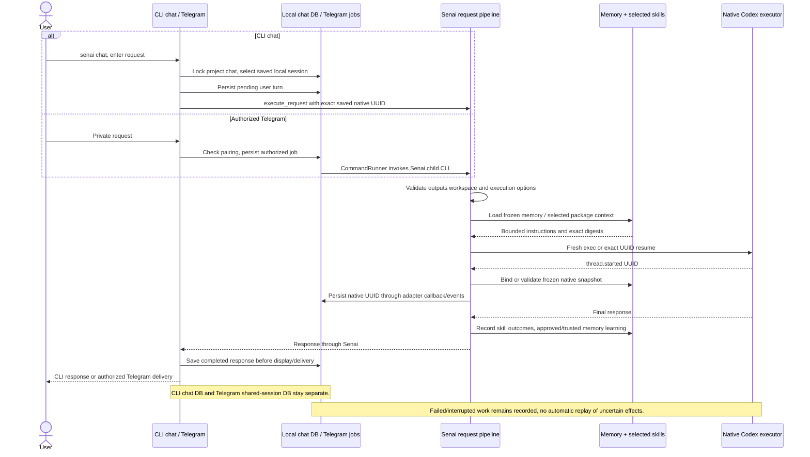
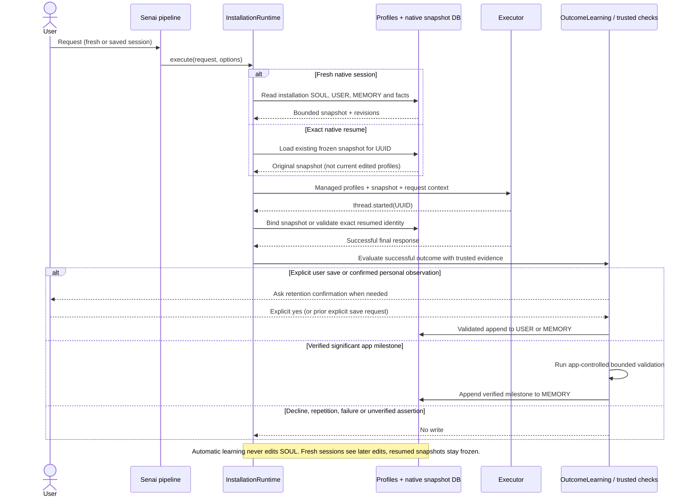
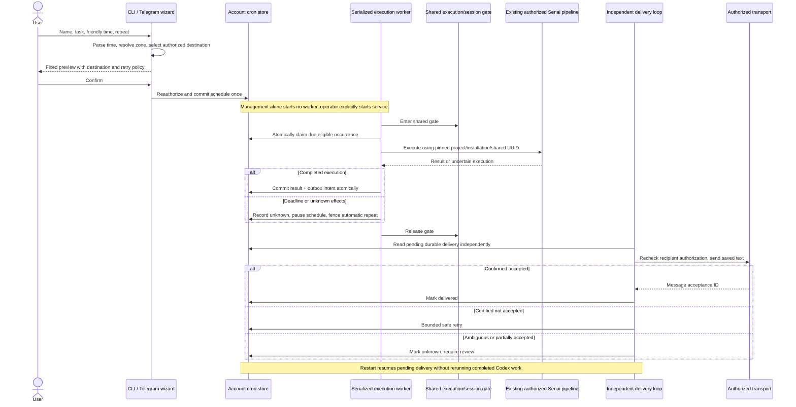
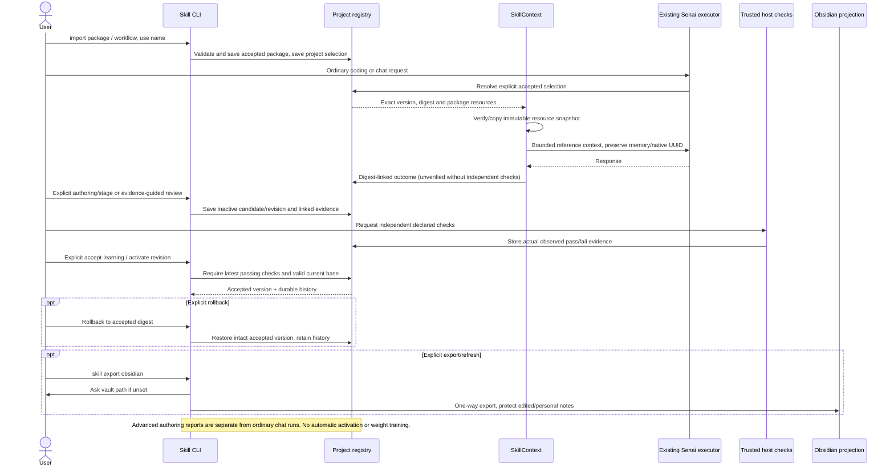

# Four module sequence diagrams

These describe the integrated execution paths. Message labels avoid literal semicolons,
which Mermaid treats as statement separators. For component/storage boundaries, see
[architecture](architecture.md); for exact commands, see [README](../README.md).

## 1. Chat and integrations: Senai owns input, history and response

## 2. Memory: fresh profiles, frozen resume and confirmed learning

## 3. Cron: guided schedule to durable execution and independent delivery

## 4. Skills: explicit selection, auditable outcomes, checked improvement

