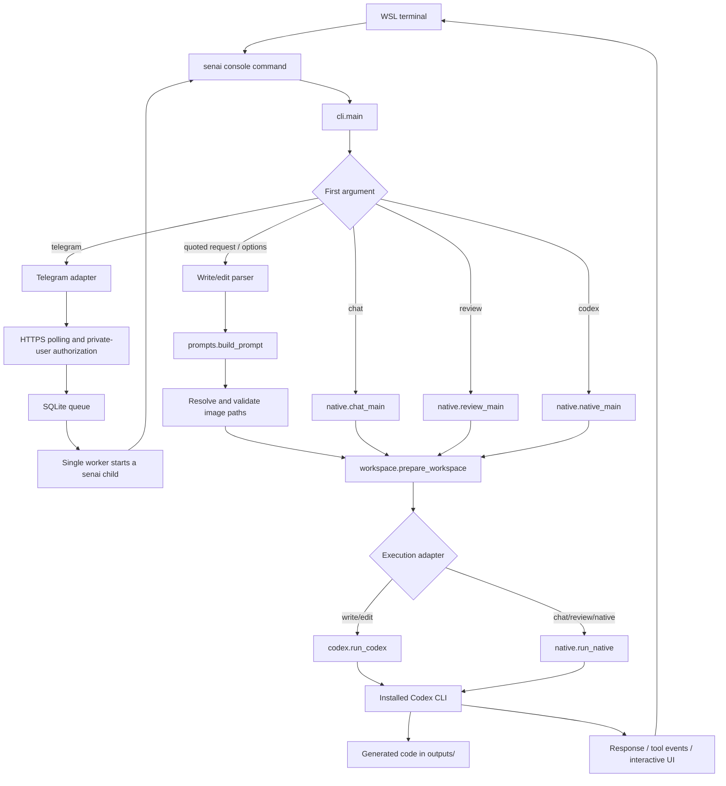

# senai architecture and execution flow

This document describes the current code, not a proposed architecture.
The authoritative checkout is `/home/rk/SentiensHermes/senai` in Ubuntu WSL.
For commands and setup, see [features.md](features.md). For hands-on verification,
see [manualqa.md](../tests/manualqa.md).

## 1. What runs where

senai is a small Python orchestration layer around the installed `codex` executable.
It does not call a model API directly or implement its own agent/tool loop.
Codex handles model access, project-file discovery, tool execution, skill loading,
authentication, and native session history.



The diagram summarizes the two execution paths; workspace preparation returns to
the mode that called it. Telegram mode adds one in-process worker thread; ordinary write/edit and native modes do not start a senai worker.

## 2. Entry points and module boundaries

| File | Responsibility | Main functions/types |
| --- | --- | --- |
| [pyproject.toml](../pyproject.toml) | Defines the installable package and `senai` console entry point. | `senai = "senai.cli:main"` |
| [__main__.py](../senai/__main__.py) | Allows `python3 -m senai`; exits with the main result. | `main()` |
| [cli.py](../senai/cli.py) | Routes modes; parses convenience flags; validates images; reports results/errors. | `main()` |
| [prompts.py](../senai/prompts.py) | Validates request/skill names and builds write/edit instructions. | `build_prompt()` |
| [workspace.py](../senai/workspace.py) | Resolves the parent project and prepares its outputs directory. | `prepare_workspace()` |
| [exec_flags.py](../senai/exec_flags.py) | Registers native exec options and collects forwarded arguments. | `add_exec_flags()`, `collect_exec_args()` |
| [options.py](../senai/options.py) | Stores explicit options and translates them into native argument lists. | `CodexOptions`, `to_args()`, `session_args()` |
| [codex.py](../senai/codex.py) | Executes one non-interactive request and captures its final response. | `run_codex()` |
| [native.py](../senai/native.py) | Interactive, review, and native forwarding paths; native argument validation. | `chat_main()`, `review_main()`, `native_main()`, `run_native()` |

Routing checks only the first argument. For example, `senai review` chooses review
mode, whereas `senai -- "review"` submits a literal write/edit request.

## 3. Trace a write/edit request

Example:

```bash
senai --project /path/to/repo --search "Create hello.py that prints Hello"
```

1. The installed console script calls `senai.cli.main()`.
2. No first-argument mode keyword matches, so the write/edit parser reads the
   optional request/stdin, project aliases, model/profile/config, images, skills,
   resume selector, and native exec flags. --version exits without a request or
   creating outputs/. Workspace-relocation conflicts fail before running Codex.
3. `build_prompt()` rejects a blank request or invalid skill name. It inserts
   literal `$skill-name` mentions when selected, write/edit instructions, and
   the stripped request inside `<user_request>` delimiters. A request of - or
   omitted request with piped stdin reads its text from stdin. Missing input on
   an interactive terminal produces a usage error.
4. Image paths are expanded and resolved relative to the caller's directory.
   Nonexistent/non-file attachments fail before creating the output workspace.
5. `prepare_workspace()` expands/resolves the parent project, checks it is an
   existing directory, rejects a symlinked outputs root, and creates outputs/.
   It does not itself validate that the project is a Git repository; Codex does.
6. `CodexOptions` stores the explicit settings. `run_codex()` validates the resume
   selector, then creates a temporary `.senai-<random>/` directory inside outputs/.
7. The adapter constructs this argument list (shown schematically):

```text
codex <optional --ask-for-approval POLICY> exec
  <sandbox selection, omitted for native approval/bypass modes>
  --cd /path/to/repo/outputs
  --color <selected policy, default never>
  --output-last-message /path/to/repo/outputs/.senai-<random>/response.txt
  <model/profile/config/image and additional native exec arguments>
  <optional --json>
  <optional resume SESSION or resume --last>
  -
```

8. `subprocess.run()` starts the child with OS cwd also set to outputs/. The
   complete prompt is sent as UTF-8 stdin; the final `-` tells Codex to read it.
   Arguments are a Python list, with no shell invocation or shell interpolation.
9. Codex performs its native work. senai captures stdout/stderr in memory and
   waits for the child in normal mode. With --json, stdout/stderr are forwarded
   directly to the caller so native events stream without buffering or parsing.
10. A nonzero child status becomes a wrapper execution error. Diagnostics prefer
    stderr, then stdout, then a fallback message. On status 0, senai reads and
    strips response.txt; a missing/empty final response is also an error.
11. A nonempty final response is printed to stdout only in normal mode; JSON mode
    does not append duplicate final text. If -o was requested, the original final
    content is copied to the validated retained path after success. Capture still
    uses a fresh temporary file, so stale retained content cannot hide a missing
    new response. Parent output directories are created when saving. The temporary directory is
    removed on normal completion or Python exception unwinding. Generated code
    remains in outputs/; forced process termination can leave temporary files.

The wrapper does not verify semantic correctness of generated code. Relevant tests
and manual inspection are separate checks. It neither retries nor imposes a timeout.

## 4. How each option reaches Codex

| senai input | Implementation | Native behavior |
| --- | --- | --- |
| `--model` / `-m` | `CodexOptions.to_args()` | Adds `--model VALUE`; otherwise preserves native defaults. |
| `--profile` / `-p` | `to_args()` | Adds `--profile VALUE`; Codex resolves the existing profile. |
| `--config` / `-c` (repeatable) | `to_args()` | Adds each native `--config KEY=VALUE` in supplied order. |
| `--image` / `-i` (repeatable) | `cli.main()` then `to_args()` | Checks file existence and passes absolute paths as separate arguments. |
| `--search` | `to_args()` | Appends `--config web_search="live"`, because exec has no direct --search flag. |
| `--skill` (repeatable) | `build_prompt()` | Adds literal skill mentions to stdin, not a separate CLI flag. |
| `--resume SESSION` | `session_args()` | Adds `resume SESSION`; rejects empty or option-like identifiers. |
| `--last` | `session_args()` | Adds `resume --last`; native cwd filtering chooses the latest session. |
| `--skip-git-repo-check` | `to_args()` | Explicitly forwards the native non-Git execution flag. |
| `--cd` / `-C` | `build_parser()` and workspace preparation | Alias for --project; outputs/ remains the execution root. |
| Sandbox and approval flags | `cli.main()` and `run_codex()` | Choose the native sandbox, or omit the default for approval/bypass modes; global -a precedes exec. |
| Other native exec flags | `exec_flags.py` and `extra_args` | Collect supported boolean/value/repeated arguments and forward them as list elements. |
| `--output-schema` | `cli.main()` | Validate an existing input file and resolve it from the caller directory. |
| `--json` | `run_codex()` | Inherit/forward output streams and omit duplicate final printing. |
| `-o` / `--output-last-message` | `resolve_output_path()` and `run_codex()` | Retain fresh final content inside outputs/ after success. |

`--resume` and `--last` are mutually exclusive. Search's explicit override is
appended after supplied config overrides, so `--search` takes precedence over
an earlier `-c web_search=...`. Model/profile/config validity, skill availability,
and image decoding are checked by Codex, not replicated in the wrapper.

Prompt delimiters express structure; they are not an independent security boundary.
The wrapper instructs Codex to read project instructions and treat reference text
as data. It does not load every project file or concatenate file contents itself.

## 5. Interactive and native execution

All three alternative modes prepare outputs/ and call `run_native()`.

| Mode | Native arguments | Default sandbox |
| --- | --- | --- |
| `senai chat` | `--no-alt-screen` | `workspace-write` |
| `senai review` | `review --uncommitted`, or selected `--base` / `--commit` | `read-only` |
| `senai codex -- ...` | Arguments after the separator, in their original order | `workspace-write` |

Their common command shape is:

```text
codex --sandbox <mode> --cd <project>/outputs <native arguments>
```

The child also has outputs/ as its OS cwd. stdin is inherited, and stdout/stderr
are forwarded to the caller's streams. There is no convenience prompt construction,
final-response capture, or temporary response file on this path. Codex owns
interactive input, approvals, `/skills`, and any JSON event stream. Native mode
can request its own `-o response.txt` final-response file inside outputs/.

`senai chat` requires a real terminal. The review adapter chooses one Git scope
and a read-only child sandbox; preparing outputs/ can still create the directory
before the child starts. Git review scope can extend to the parent repository.

`validate_native_args()` runs before spawning the native child. It rejects
explicit --cd/-C, --add-dir, --worktree, and --remote relocation, and checks known
output flags (--output-last-message/-o, --out, --output) resolve inside outputs/.
It handles relative, absolute, and supported attached/equal-sign path forms.
It stops interpreting tokens after a native `--` literal-argument separator.
Other native arguments are delegated rather than reimplemented.

## 6. Files, state, and ownership

| Data | Location / owner | Lifetime |
| --- | --- | --- |
| Wrapper implementation | senai/ in this repository | Git-tracked source. |
| Tests and guides | tests/, projectprogress/, root documentation | Git-tracked development records. |
| Retained convenience final response | Explicit validated -o path inside outputs/ | Written after success; survives temporary cleanup. |
| Generated product code | `<selected project>/outputs/` | Retained; ignored by this repository's Git settings. |
| Convenience final response | `outputs/.senai-<random>/response.txt` | Temporary; printed and normally cleaned up. |
| Native explicit output files | Validated output paths inside outputs/ | Retained as requested. |
| Model authentication, configuration, installed tools/skills, sessions | Native Codex user/config locations | Managed by Codex, not a custom senai store. |
| Convenience subprocess diagnostics | Python memory normally; forwarded stderr in JSON mode | Printed on failure or streamed; not automatically saved to a log file. |

Selecting outputs/ expresses the intended code workspace. It is not an independent
filesystem jail. Native configuration, permissions, repository discovery, and external
tools still apply; senai does not inspect every arbitrary command or config value.
Native account/configuration management can update normal Codex user state.

The wrapper does not automatically commit generated files or export full chat
history. Development Git commits and progress documents are maintained separately.
No custom semantic memory, skill-learning engine, or scheduler exists. Telegram supplies a text-message transport around the existing execution path.

## 7. Return codes and failures

| Situation | Result |
| --- | --- |
| Write/edit child succeeds with a nonempty final message | Print message; return 0. |
| Write/edit child fails | Print native status/diagnostics to stderr; return 2. |
| Missing executable, invalid workspace/image/skill/session, or empty final message | Print an actionable wrapper error; return 2. |
| Invalid parser options / incompatible selectors | argparse reports usage and exits 2 before execution. |
| Help request | argparse displays help and exits 0. |
| Chat/review/native child exits normally or fails | Preserve native child exit status and streams. |
| KeyboardInterrupt reaches the wrapper | Return 130; write/edit also prints an interruption message. |

The wrapper can leave partial generated edits when Codex fails or is interrupted.
It does not roll back project files. It also does not implement process-group
termination or a job supervisor; native child/terminal behavior remains relevant.

## 8. Tests that support this design

| Behavior | Tests |
| --- | --- |
| Input, prompt context, workspace, and invalid paths | [test_cli.py](../tests/test_cli.py) |
| Subprocess invocation, final response, failures | [test_codex.py](../tests/test_codex.py) |
| Native exec option coverage and non-Git regression | [test_exec_compat.py](../tests/test_exec_compat.py), [test_git_option.py](../tests/test_git_option.py) |
| JSON streaming, retained response paths, stale-output protection | [test_output_options.py](../tests/test_output_options.py) |
| Model/profile/config transport | [test_options.py](../tests/test_options.py) |
| Images, search, skill mentions, sessions | [test_images.py](../tests/test_images.py), [test_search.py](../tests/test_search.py), [test_skills.py](../tests/test_skills.py), [test_resume.py](../tests/test_resume.py) |
| Interactive streams and native argument/output policy | [test_chat.py](../tests/test_chat.py), [test_native.py](../tests/test_native.py) |
| Review scopes and read-only choice | [test_review.py](../tests/test_review.py) |
| Installed command through a real, deterministic fake child | [test_installed.py](../tests/test_installed.py) |

The current suite has 136 offline tests. These verify wrapper behavior, not every
live account/tool/model combination. Live verification evidence is recorded in
[CHANGELOG.md](../CHANGELOG.md); the manual checklist records user-observed outcomes.

## 9. Maintain this document

Whenever code changes entry points, mode routing, module ownership, command
construction, workspace policy, storage, streams, or failure behavior:

1. Add a failing behavior test, implement the change, and verify it.
2. Update the matching section here and the user guide/manual QA steps as needed.
3. Update the progress records and CHANGELOG.md, then commit the change.

Keep examples aligned with actual source. Label planned components as planned;
do not draw them as part of the running implementation.

Compatibility scope: the option coverage test compares build_parser() against installed codex exec --help. Interactive/global subcommands still use native adapters. Workspace-relocating exec flags are recognized but rejected under the outputs policy.


## 10. Telegram execution path

The first argument `telegram` lazily loads [telegram/cli.py](../senai/telegram/cli.py).
It parses local startup settings and credentials before any remote execution.
--setup reads a random private onboarding phrase and prints a user ID; --check
checks identity/webhook state. Neither mode executes requests or sends bot replies.

| Module | Role |
| --- | --- |
| [telegram/api.py](../senai/telegram/api.py) | HTTPS JSON Bot API transport; sanitized errors/rate-limit metadata. |
| [telegram/config.py](../senai/telegram/config.py) | Token loading, per-project config discovery, atomic private env saving, and legacy optional allowlist. |
| [telegram/router.py](../senai/telegram/router.py) | Authorize private sender/chat identities, route commands, enqueue literal requests. |
| [telegram/store.py](../senai/telegram/store.py) | SQLite cursor, bounded jobs, atomic claims, interrupted recovery, and delivery outbox. |
| [telegram/runner.py](../senai/telegram/runner.py) | Run the existing senai module in a child process, retaining stdout/stderr logs. |
| [telegram/service.py](../senai/telegram/service.py) | Polling, responsive status/reply delivery, one worker thread, process lock. |
| [telegram/formatting.py](../senai/telegram/formatting.py) | Split plain-text replies below Telegram limits, preserving Unicode. |

Startup validates bot identity and refuses an existing webhook without deleting it.
State is outputs/.senai-telegram/<bot-id>/ with a private bot directory, SQLite DB,
lock, and per-job logs. The local flock prevents a second poller for that bot/project.
Startup skips pending remote updates, then starts the worker and polling loop.
Already accepted queued jobs persist; previously running jobs become interrupted
and are not automatically re-executed.

The polling thread records update consumption and job insertion in one transaction.
Only paired (or legacy allowed), non-bot private users can submit requests; local revocation overrides either route. It acknowledges queued
work and answers /status without waiting for the worker. Group/unauthorized/edited
updates do not execute. Requests and results are scoped to the requesting chat for
status and delivery, while the configured output workspace is intentionally shared.

The worker claims one queued row atomically, rechecks dynamic pairing/legacy authorization, and runs:

```text
<python> -m senai --project <configured project>
  --ask-for-approval never
  <optional skip-git/model/profile/search/skill settings>
  --json --output-last-message <job>/response.txt
  <optional --resume SAVED_SHARED_ID>
  -- <literal Telegram request>
```

No shell is used. The request cannot inject CLI flags because it follows --.
TELEGRAM_BOT_TOKEN and TELEGRAM_ALLOWED_USER_IDS are removed from the child environment.
The child follows the ordinary write/edit execution path documented above, creating the shared native conversation once and subsequently resuming its saved ID. This is not a second implementation of the agent.

Results are saved durably before delivery. The polling side sends split plain-text
parts to the authorized requesting chat and records each successful send. A send
failure never retries code execution. A crash between remote acceptance and local
marking can duplicate a reply part; exactly-once message delivery is not guaranteed.
Prompt/output history and full local stdout/stderr logs remain under outputs/.
Telegram result text is capped at 60,000 characters with a path to the full local log.

Transient API/network failures retry with bounded waits and available retry_after.
Invalid credentials/access/polling conflicts stop the service. Ctrl+C stops polling
and waits for an active job; queued work/results persist. There is no remote /cancel,
no terminal approval bridge, no incoming attachment handling, and no file-download
transport. Native workspace/config/tool security limits still apply.

The bot needs outbound internet and a running WSL process, not an inbound webserver.
The current Telegram verification is offline: API fixtures, store/router tests,
real worker-thread tests, and an end-to-end real senai child with fake Codex.
The user confirmed live Telegram operation on 2026-11-08. The detailed manual acceptance checklist remains available for regression testing.


## 11. Automated pairing and shared session upgrade

[telegram/wizard.py](../senai/telegram/wizard.py), invoked by
[scripts/setup_telegram.sh](../scripts/setup_telegram.sh), replaces the repeated
manual export/user-ID steps. It validates a hidden token, drains stale updates,
then shows a one-use pairing code. On a matching private message it grants the
account and atomically saves a mode-600 per-project env file outside the workspace.
--configure --start continues into service startup using the just-validated token.
Normal later starts discover the config by resolved-project hash. Explicit env
files/exports and old numeric allowlists remain supported.

[telegram/connection.py](../senai/telegram/connection.py) shares bot/webhook
validation and state-directory preparation between the wizard and server.
[telegram/pairing.py](../senai/telegram/pairing.py) hashes random codes, expires them
after ten minutes, and redeems them atomically into paired_users. /pair is the only
unauthenticated private command processed; it cannot execute code. Issuing a new
local code invalidates the prior unused one. Local --revoke-user records an explicit
denial that overrides even legacy allowlists and affects queued work/delivery.

The existing SQLite DB is migrated in place: sessions, paired_users, pairing_codes,
and a jobs.session_id column are added without removing old jobs or update cursors.
There is one session named telegram-shared per bot/project, shared intentionally
by every authorized account. It is not a user privacy partition.

The runner now requests native JSON events and a separate final-response file.
It accepts a UUID from the native thread.started event, binds it to the shared
mapping/job, and uses --resume EXACT_ID on every later turn. It never guesses
with --last and never silently replaces a missing/failed resumed session. Missing
first-session metadata fails visibly instead of reverting to one-off behavior.
The raw event log allows recovery of a first-session ID from interrupted work
before marking that job interrupted. Existing one-off transcripts are not merged.

/session displays the saved ID to authorized accounts. Disconnecting Telegram,
restarting the bot, or pairing another account leaves the mapping intact. All
members share model history and files; per-chat /status and /result only control
which job records are directly displayed/delivered.

Verification: test_telegram_sessions.py covers exact-ID resumption and old-schema
migration; test_telegram_pairing.py covers code expiry/use/revocation;
test_telegram_wizard.py covers protected configuration, setup races, and startup.
Live Codex turns confirmed memory after runner/store restart for a second simulated
user. The new wizard/pairing protocol has not yet been live-tested with the bot.

## Parallel development ownership

The four feature worktrees have isolated environments/runtime fixtures. Their module
architectures live under workstreams/<feature>/architecture.md until integration.
This aggregate architecture and the shared CLI/execution seams remain coordinator-owned.
See [execution boundaries](parallel/execution-contract.md). No new runtime hook or feature
was added merely by preparing these worktrees.

## Modular delivery guardrails

[Merge policy](parallel/MERGE_POLICY.md) and ownership.json define one writer per module/path.
Feature-local delivery.json describes public APIs, executor shape, dependencies, storage,
migrations, and test evidence; shared integration-notes.md proposals stay unapplied until
coordinator integration. The scope guard checks Git ownership and declared readiness.
The coordinator alone updates shared CLI/hooks/packaging/aggregate docs and merges sequentially.

## Telegram integration merge (2026-11-09)

Telegram now passes private updates through TelegramAdapter into the existing authorized queue and exact shared Codex session. Chat instructions enrich each request without changing saved prompts. Delivery snapshots persist exact redacted chunks; legacy partial replies preserve their original headers and boundaries. Storage migration only adds a table.

## Telegram media outbox

CommandRunner prepares selected image snapshots and optional speech; BotService sends durable text then MediaOutbox uploads snapshots with a separate media.sqlite3 cursor. Existing job/session/pairing tables are retained. Dedicated speech credentials are excluded from Codex child environments; native Codex API authentication remains available.

## Installation memory integration (2026-11-09)

Memory is opt-in through one explicit existing installation root:
    export SENAI_INSTALLATION_ROOT=/absolute/path/to/installation
    senai --project /absolute/path/to/project-a "Remember in USER.md: Prefers concise replies"
    senai --project /absolute/path/to/project-b "What response style do I prefer?"

Alternatively pass --installation ROOT on each call. The installation root stays constant across projects; no inference from cwd, home, package location or Telegram identity. One owner per installation only. USER.md and MEMORY.md live at ROOT/outputs/.senai-memory/, alongside human-controlled SOUL.md and memory.db.

Direct management is available as senai memory --installation ROOT remember USER.md "Prefers concise replies" --user-requested. With SENAI_INSTALLATION_ROOT configured, the memory subcommand uses that root automatically.

Fresh execution loads a bounded InstallationMemory snapshot. Native thread.started events bind it in native-snapshots.sqlite3; exact --resume ID reuses that persisted snapshot without rereading changed profiles. --last, ephemeral mode and sessions without a stored snapshot fail clearly rather than silently selecting/rebuilding context. Existing native sessions and old scoped memory are retained and not silently adopted/imported. Unconfigured runs retain the original execution path. Native interactive/pass-through commands do not gain memory injection.

Explicit requests "Remember in USER.md: FACT", "Remember in MEMORY.md: FACT", or "Remember that FACT" are saved after successful execution (the latter defaults to MEMORY.md). Telegram's presentation wrapper is supported when its child inherits the explicitly configured root; no production bot was enabled/restarted for this integration. Automatic SOUL save requests are rejected. App-managed profile instructions are cooperative; this is not a sandbox against hostile filesystem writes.

Trusted app validators can call InstallationRuntime.execute(..., learning=validator). The validator receives (request, successful_response, workspace) and returns LearningDecision objects. A noteworthy event requires noteworthy=True AND verified=True; user_requested must represent real user authorization. Ordinary model output, "Memory:" lines and success text never grant verification or trigger implicit saving. No autonomous noteworthy classifier is introduced. Learning does not refresh an existing session's frozen context.

Integrated feature/memory through 3146de5 in merge 0f0c979. Coordinator lifecycle wiring: 62cbf9f. Feature scope/readiness passed before merge, with 176 offline tests (40 memory tests). Combined regression: 235 passed, including existing Telegram media/auth tests, 40 memory tests and 11 coordinator memory lifecycle tests. TDD logs include failing missing-runtime and SOUL-write tests before implementations.

Real isolated Codex acceptance at 62cbf9f: project A saved a harmless USER.md fact; a distinct fresh session in project B recalled it from the same installation. Exact-ID resume also succeeded. No production bot state, jobs, pairing, sessions or credentials were copied or used; no push, deployment or production restart.

Evidence:
- outputs/memory-combined-regression.log
- outputs/memory-transport-tests.log
- outputs/qa-memory-installation/acceptance.json
- outputs/qa-memory-installation/first-session.jsonl
- outputs/qa-memory-installation/final-fresh-session.jsonl
- outputs/qa-memory-installation/final-resume.jsonl

## Cron integration (2026-11-09)

Merged feature/cron through 46e739d (6a50762); wiring 7e6cf18. Consolidated pinned dependencies, shared senai cron management, opt-in /cron management, existing serialized native-session execution, and currently authorized durable text delivery. All 299 combined tests passed; installed CLI fixture QA and dependency checks passed. Production state/services untouched; live scheduling remains disabled and unverified. See projectprogress/cron.md for usage and limits.
